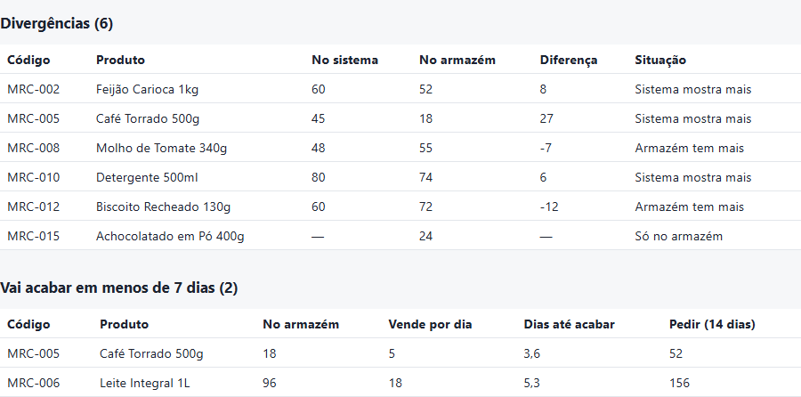
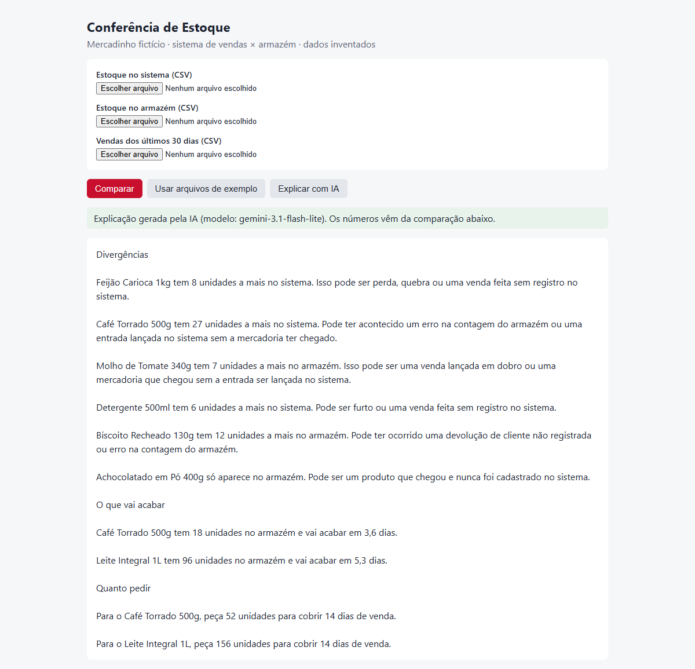
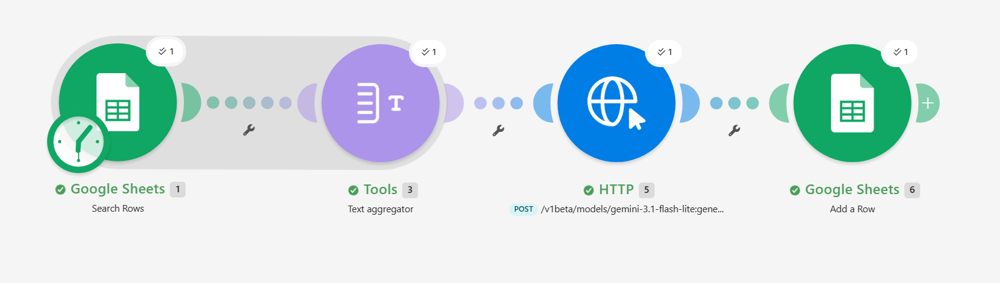

# Conferência de Estoque (demo)

Compara o estoque do sistema de vendas com a contagem do armazém, aponta o que vai acabar pelo ritmo de vendas e calcula quanto pedir para cobrir 14 dias. Depois, a IA (Gemini) explica o resultado em português simples para o dono do mercadinho.

**Todos os dados são inventados** (mercadinho fictício, pasta `exemplos/`).

**Demo publicada:** https://demo-estoque-ashy.vercel.app

## Antes e depois
- **Antes:** conferir o estoque na mão, comparando produto por produto o que o sistema de vendas diz com o que foi contado no armazém, e calcular sozinho o que vai acabar e quanto pedir.
- **Depois:** subir 3 CSVs (estoque no sistema, contagem do armazém e vendas dos últimos 30 dias) e receber as tabelas com as divergências, o que acaba em menos de 7 dias e quanto pedir, mais uma explicação em português simples.

## Prints
Tabelas calculadas pelo código (`compararEstoques()`):



Explicação gerada pelo Gemini a partir dessas tabelas:



## Como funciona
1. O navegador lê os três CSVs e faz **todas as contas** (`compararEstoques()` em `app.js`).
2. Só o resultado da comparação vai para o servidor (`api/analisar.js`), não os CSVs.
3. O servidor chama o Gemini (`gemini-3.1-flash-lite`) com a chave que fica só nele. A IA explica; não calcula.

## Como rodar no computador
Testado com Node.js 24 (o `npm run local` usa a opção `--env-file-if-exists`, que não existe em versões antigas do Node).

1. Copie `.env.example` para `.env` e cole a chave do Google AI Studio depois de `GEMINI_API_KEY=`.
2. Rode:
   ```bash
   npm run local
   ```
3. Abra http://localhost:3000, clique em **Usar arquivos de exemplo** e depois em **Explicar com IA**.

O `servidor-local.js` imita a Vercel e serve só a página, o `app.js` e os CSVs de exemplo (nunca o `.env`).

Abrir o `index.html` com duplo clique não funciona: o navegador bloqueia a leitura de `exemplos/` e não existe `/api` sem servidor.

## Versão no Make
A mesma ideia, sem código, montada no Make:

1. **Google Sheets:** a planilha tem os dados e faz as mesmas contas em fórmulas (diferença, dias até acabar e quanto pedir para 14 dias).
2. **Text aggregator:** junta as linhas do resultado num texto só.
3. **HTTP:** envia esse texto para a API do Gemini.
4. **Google Sheets:** grava a resposta numa aba da planilha.

Mesma regra da versão em código: as contas ficam na planilha, e a IA só explica.



## Na Vercel
A chave entra em *Settings → Environment Variables* com o nome `GEMINI_API_KEY`. O `.env` está no `.gitignore` e nunca vai para o Git.

## Limitações
- No nível gratuito do Gemini, o Google pode usar os dados enviados para melhorar os produtos dele. Por isso a demo usa só dados inventados.
- O endpoint `/api/analisar` é público: qualquer pessoa com o link consome a cota da chave.
- O leitor de CSV não trata vírgula dentro do nome do produto.
